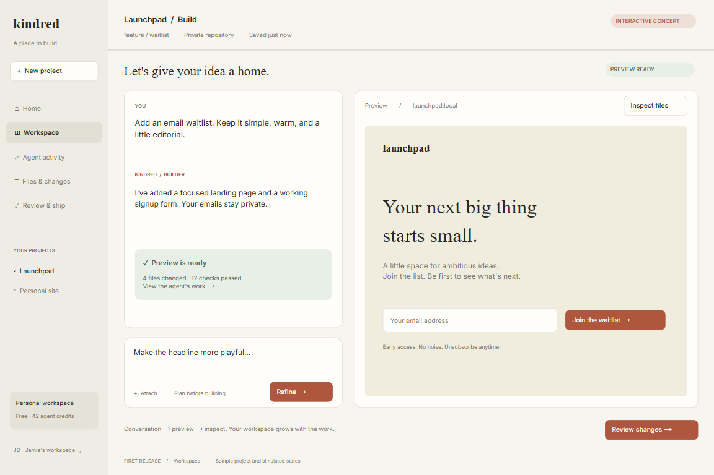

# Yudw — Kindred application build pack

A staged Cursor prompt pack for building an AI-first development workspace: describe a change, watch an agent work, preview the result, inspect the diff, approve a revision, and ship it.

This repository currently contains the build instructions and an interactive visual prototype. The production application has not been implemented yet. **Kindred** is the working product name.

## Start in Cursor

1. Open this repository in Cursor.
2. Read [the setup guide](build-pack/START-HERE.txt).
3. Copy [the kickoff prompt](build-pack/prompts/00-kickoff.txt) into Cursor Agent.
4. Continue through prompts `01` to `14`, one stage at a time. Each stage includes a completion gate.

Project instructions are already installed in [.cursor/rules/kindred.mdc](.cursor/rules/kindred.mdc). Use the resume and repair prompts when continuing in a fresh chat or fixing a failed stage.

## Contents

- [Product specification](build-pack/PRODUCT.txt)
- [Architecture](build-pack/ARCHITECTURE.txt)
- [External-service setup](build-pack/SETUP.txt)
- [Acceptance criteria](build-pack/ACCEPTANCE.txt)
- [All 18 prompts](build-pack/ALL-PROMPTS.txt)
- [Prototype references](build-pack/references/)

Open `build-pack/references/home.html` in a browser to explore the five linked prototype screens. The reference folder also includes PNG screenshots and editable Design Studio JSON exports.

## Proposed first-release stack

Next.js and TypeScript, Supabase Auth/PostgreSQL/private storage, Drizzle, Inngest, Vercel Sandbox, Vercel AI SDK with an Anthropic model, GitLab.com, and Vercel deployments. The kickoff prompt verifies current APIs and compatibility before implementation.

The initial release uses an existing Git provider; independent Git hosting is a later milestone. Demo mode and live integrations remain separate. The visual prototype simulates inputs, agent runs, checks, and shipping.

No credentials are included. Configure secrets outside chat and version control. This pack does not authorize automatic production deployment or paid resource purchases.
